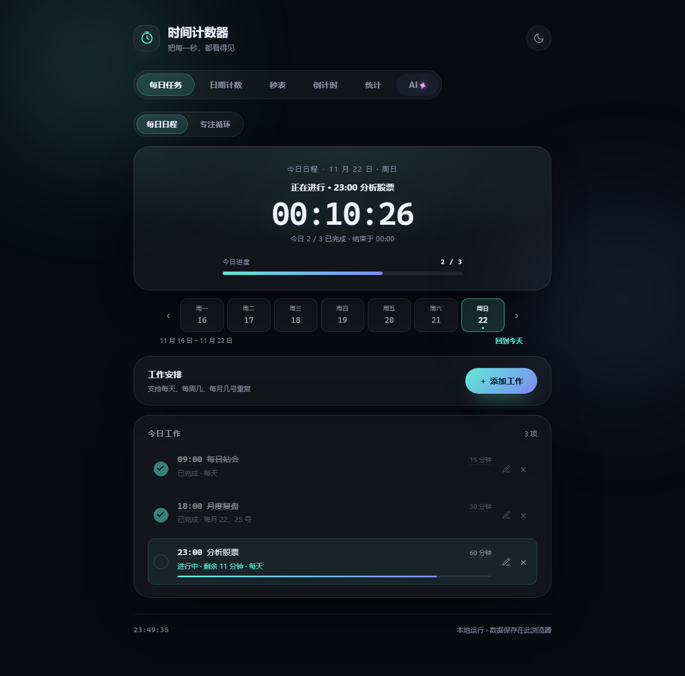
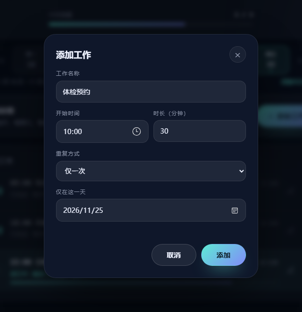
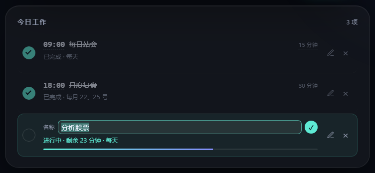
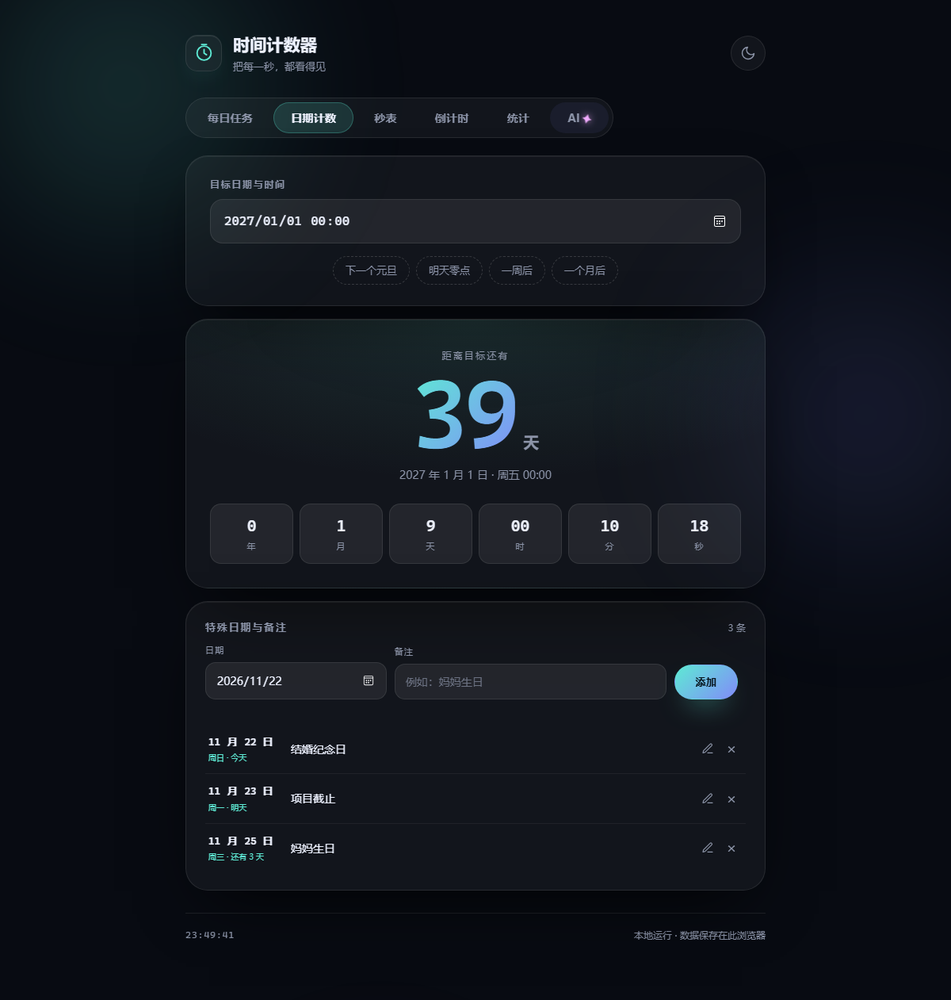
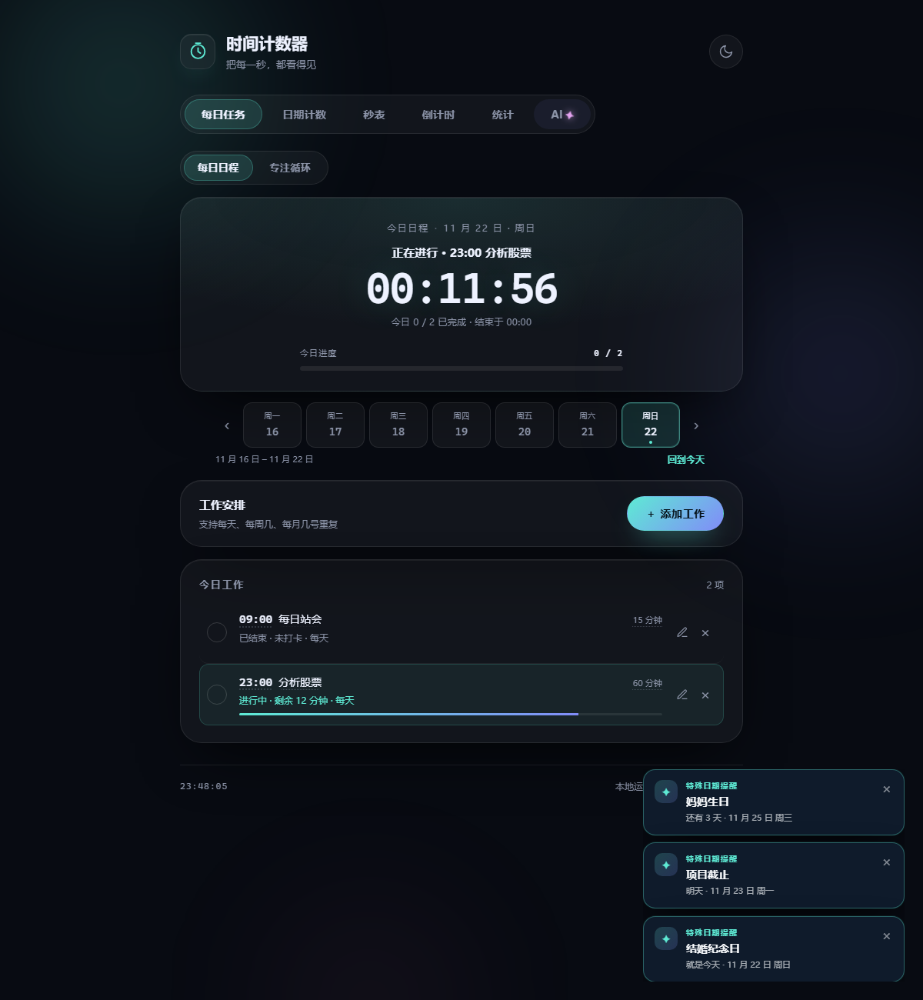
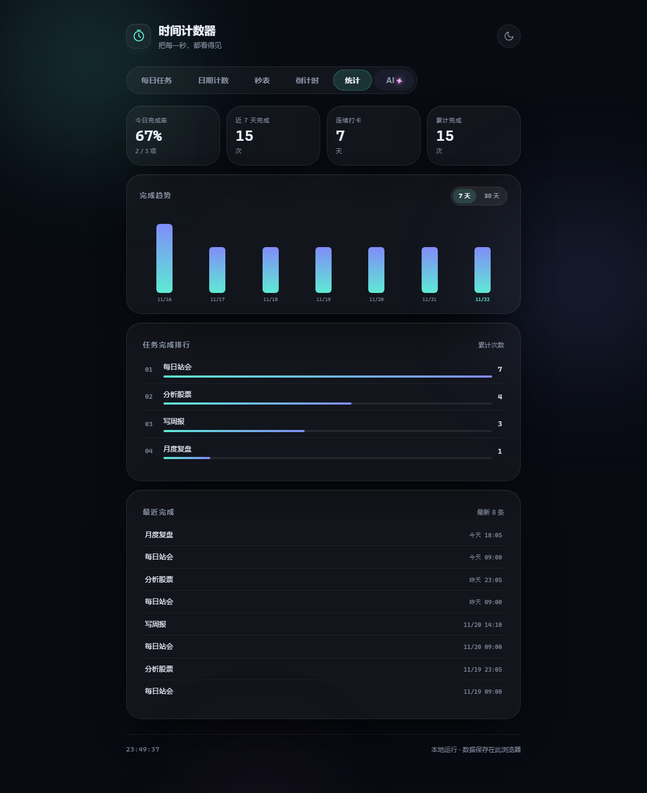
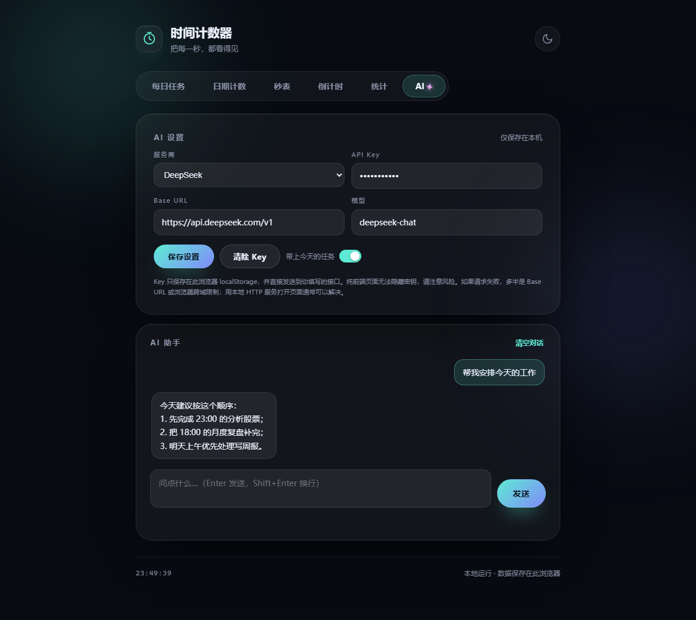
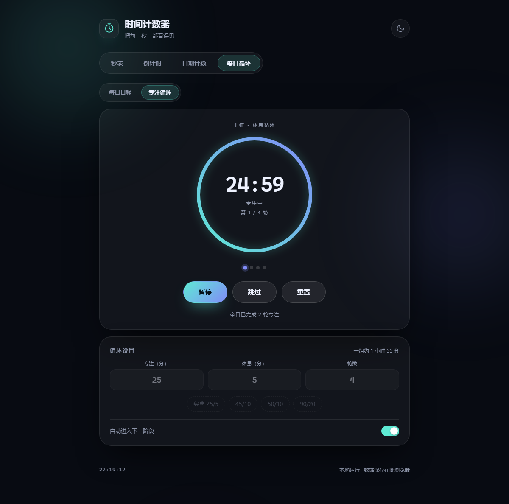

# 时间计数器

一个纯前端、零依赖的时间小工具：每日任务、日期计数、秒表、倒计时、统计、AI。直接双击 `index.html` 就能用，不需要安装。

## 功能

### 每日任务

第一个标签页，默认打开。支持 **每天 / 每周几 / 每月几号 / 仅一次** 四种重复方式，一天可以安排任意多项任务。

- 顶部日期条按周展示，左右箭头切换周，点任意一天查看当天清单
- 今天实时显示「正在进行 / 下一项」倒计时和今日进度；过去日期可补打卡，未来日期是计划视图
- 同一天可以放任意多项任务，互不冲突
- 删除带 6 秒撤销

#### 重复规则

- **每天**：每天出现
- **每周**：可多选周一至周日，例如每周一、三、五
- **每月**：可写多个日期，例如 1, 15, 28；没有 31 号的月份自动跳过
- **仅一次**：只在这一天出现，适合一次性的会议、体检、截止日等
- 每行的铅笔按钮打开统一弹窗，可同时修改名称、时间、时长和重复规则

#### 直接点击字段修改

- 点击列表中的 **名称 / 开始时间 / 时长** 即可原位编辑
- `Enter`、失焦或点右侧 `✓` 保存，`Esc` 取消
- 名称为空、时间无效或时长越界会提示并还原

### 日期计数

- 选择任意日期时间，自动判断正向倒数或回顾已过去的时间
- 大字显示总天数，下方精确到 年 / 月 / 天 / 时 / 分 / 秒
- 快捷入口：下一个元旦、明天零点、一周后、一个月后
- 目标日期可以直接编辑

#### 特殊日期与备注

- 在日期计数页底部新增「特殊日期与备注」
- 可添加、编辑、删除特殊日期：生日、纪念日、截止日等
- 每条包含日期和备注，列表显示星期、今天 / 明天 / 还有几天 / 已过去几天

#### 右下角提醒

- 在特殊日期 **提前 3 天、提前 1 天、当天** 时，右下角弹出提醒卡片
- 同一特殊日期的同一个提醒阶段只弹一次，刷新页面不会重复
- 多条提醒会叠放在右下角，10 秒自动消失，也可手动关闭
- 提醒在页面打开时检查；关闭页面后无法推送系统通知
- 提醒只保存在本浏览器，不会发送通知到系统

### 秒表

- 开始 / 暂停 / 继续 / 重置
- 计次记录，自动标出最快圈（青色）与最慢圈（红色）
- 以 0.01 秒精度显示，刷新页面后归零

### 倒计时

- 支持 时 / 分 / 秒 输入，最长 99:59:59
- 常用预设：1、3、5、10、25 分钟和 1 小时
- 环形进度条实时显示剩余比例
- 最后 10 秒数字变红闪烁
- 结束时播放三声提示音，移动端支持震动
- 运行中显示预计结束时间，并同步到浏览器标签标题

### 统计

- **今日完成率**：今天已完成 / 今天应完成
- **近 7 天完成**、**连续打卡**、**累计完成**
- 近 7 天 / 30 天完成趋势柱状图
- 任务完成排行和最近完成记录
- 完成记录保存在本地；删除任务不会删除历史记录

### AI 助手

- 主标签栏的 AI 带星标提醒；兼容 OpenAI 格式的 `/chat/completions` 接口
- 内置 DeepSeek、OpenAI 预设，也可以填自定义 Base URL 和模型
- 用户自己填写 API Key；Key 只保存在本浏览器 `localStorage`
- 可勾选「带上今天的任务」，让 AI 根据日程和完成情况给出安排建议
- 支持多轮对话、清空对话；请求失败会显示具体错误

> AI 是由浏览器直接请求你填写的接口，没有中间服务器。纯前端页面无法隐藏密钥，请使用自己的 Key 并注意风险。如果遇到网络 / 跨域错误，通常是 `file://` 打开导致，可在项目目录执行 `python -m http.server 8000`，然后访问 `http://localhost:8000`。

### 专注循环

- 工作 / 休息自动轮换，可自定义专注时长、休息时长和轮数
- 开启「自动进入下一阶段」后无需手动点击；也可以关闭后手动衔接
- 阶段切换播放轻柔提示音，全部完成播放三声提醒
- 轮次圆点 + 环形进度，清楚看到当前进行到第几轮
- 跳过当前阶段、暂停、重置
- 今日已完成专注轮数统计，跨天自动归零

## 快捷键

| 按键 | 作用 |
| --- | --- |
| `空格` | 开始 / 暂停当前模式（秒表、倒计时、专注循环） |
| `←` / `→` | 在标签页之间切换（需先聚焦标签栏） |

## 说明

- 主标签顺序：**每日任务、日期计数、秒表、倒计时、统计、AI**。
- 主题（深色 / 浅色）会跟随系统；手动切换后会记住选择。
- 任务、重复规则、完成记录、特殊日期、提醒标记、专注设置和 AI 设置都保存在浏览器 `localStorage` 中。
- 旧版日程会自动迁移：原来的 `doneOn` 今日打卡会变为完成记录；旧任务默认按「每天」重复，可在弹窗里改成每周、每月或仅一次。
- 除 AI 请求外，页面没有任何第三方依赖与网络请求，可离线使用。
- 时间均按浏览器本地时区计算。

## 文件

| 文件 | 说明 |
| --- | --- |
| `index.html` | 页面结构 |
| `style.css` | 样式、主题与响应式布局 |
| `app.js` | 计时、任务、特殊日期、提醒、统计、AI 与本地存储逻辑 |
| `preview.png` | 每日任务预览 |
| `preview-edit.png` | 重复规则弹窗（含仅一次） |
| `preview-inline.png` | 点击字段直接修改 |
| `preview-special.png` | 特殊日期与备注 |
| `preview-reminders.png` | 右下角提醒 |
| `preview-stats.png` | 统计页 |
| `preview-ai.png` | AI 助手 |
| `preview-focus.png` | 专注循环 |
